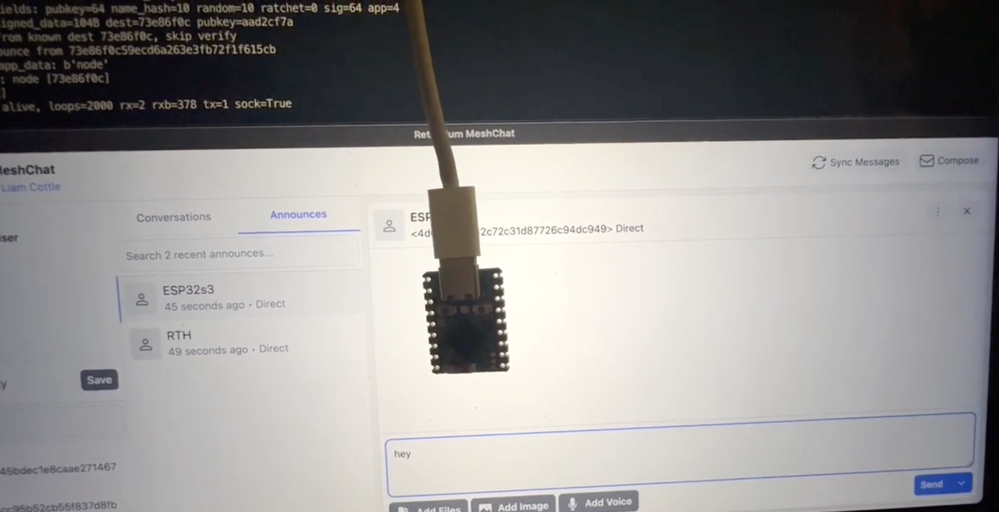
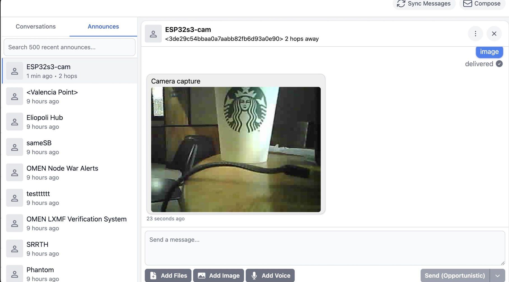

# µReticulum

A pure MicroPython implementation of the [Reticulum](https://reticulum.network/) network stack for ESP32-S3 and RP2040 microcontrollers. Send encrypted, signed messages from a $4 board to phones and laptops running [MeshChat](https://github.com/liamcottle/reticulum-meshchat), [Sideband](https://unsigned.io/sideband/), and [NomadNet](https://github.com/markqvist/NomadNet) — over WiFi, LoRa, or a TCP transport server.



[Youtube demo](https://youtu.be/Z38h_L_7n5E?si=eokB7pQE_kPDuqo0)

**Wire-compatible with reference Reticulum** — µReticulum nodes appear as normal peers in MeshChat / Sideband / NomadNet, with full LXMF messaging support and delivery receipts.

---

## What can I build with this?

Each row below is a working example in the `firmware/` folder. Pick the one closest to what you want, then follow the matching walkthrough further down.

| Goal | Example | Hardware | Connectivity |
|------|---------|----------|--------------|
| Chat with friends from a cheap board, control GPIO over LXMF | [`example_node.py`](#1--chat-node-example_nodepy) | ESP32-S3-Zero | WiFi |
| Run a tiny webserver-like portal reachable over Reticulum | [`example_nomadnet_node.py`](#2--nomadnet-page-server-example_nomadnet_nodepy) | ESP32-S3-Zero (+ optional sensors) | WiFi, LoRa, or TCP |
| Take a photo on demand and have it delivered as an LXMF attachment | [`example_camera_node.py`](#3--camera-node-example_camera_nodepy) | ESP32-S3-CAM + OV2640 | WiFi |
| Battery-powered sensor that wakes, reports, sleeps | [`example_sensor.py`](#4--sensor-node-with-deepsleep-example_sensorpy) | Any ESP32-S3 + sensor | WiFi |
| Pocket terminal: chat over LoRa using a USB serial cable, no app needed | [`example_proxy.py`](#5--usb-serial--lora-chat-bridge-example_proxypy) | RP2040 + E32/SX1262 LoRa | LoRa |

---

## Hardware shopping list

These are the boards µReticulum has been tested on. All are inexpensive and easy to find on Aliexpress / Amazon / Seeed / Waveshare.

| Board | Price | Good for | Notes |
|-------|------:|----------|-------|
| [Waveshare ESP32-S3-Zero](https://www.waveshare.com/wiki/ESP32-S3-Zero) | ~$4 | First-time users, chat/sensor/NomadNet nodes | ESP32-S3, 2 MB PSRAM, onboard NeoPixel LED, USB-C, 24.8 × 18 mm |
| [Seeed XIAO ESP32-S3](https://wiki.seeedstudio.com/xiao_esp32s3_getting_started/) + [Wio-SX1262 LoRa kit](https://wiki.seeedstudio.com/wio_sx1262_xiao_esp32s3_for_lora/) | ~$25 | LoRa + WiFi nodes that interop with RNode | XIAO + SX1262 stack |
| [ESP32-S3-CAM (OV2640)](https://www.aliexpress.com/item/1005008285512156.html) | ~$10 | Anything with the camera example | Many clones available — pick one with PSRAM |
| [Waveshare RP2040-Zero](https://www.waveshare.com/rp2040-zero.htm) + [EByte E32-900T20D](https://www.cdebyte.com/products/E32-900T20D/7) | ~$10 | Cheapest LoRa option, USB serial chat | Wiring + power notes in the [E32 LoRa Interface](#e32-lora-interface-ebyte-e32-900t20d) section |
| [LilyGO T-Deck](https://lilygo.cc/products/t-deck) v1 | ~$60 | Portable LoRa messenger with display + keyboard | Uses a separate GUI project: [reticulum-tdeck](https://github.com/varna9000/reticulum-tdeck) |

Should also work on other ESP32-S3 boards and Raspberry Pi Pico W. **Pure ESP32 (non-S3) is no longer supported** — the project targets ESP32-S3 and RP2040.

---

## Companion apps (run these on your laptop / phone)

µReticulum is the embedded peer — you talk to it from a desktop or phone app. Install at least one of these to actually use your node:

| App | Platform | What it gives you |
|-----|----------|-------------------|
| [MeshChat](https://github.com/liamcottle/reticulum-meshchat) | macOS, Windows, Linux, web | Chat + network visualizer. **Easiest first app.** Pairs over LAN UDP automatically. |
| [Sideband](https://unsigned.io/sideband/) | Android, Linux | Mobile-friendly chat, can join via LoRa hardware too |
| [NomadNet](https://github.com/markqvist/NomadNet) | Terminal (Linux/macOS) | Browse µReticulum-served pages (like a tiny web) |
| [Reticulum / RNS](https://github.com/markqvist/Reticulum) | Python | The reference stack and CLI tools (`rnstatus`, `rnpath`, `rnprobe`) |

If you only install one, install **MeshChat** — your node will appear in its peer list within a few seconds of booting on the same LAN.

---

## Installation

### Step 1 — Flash MicroPython to your board

You have two choices of firmware. Pick the one that matches what you want to build:

| Firmware | Use when | Download |
|----------|----------|----------|
| **Standard MicroPython 1.22+** | All examples *except* the camera node | [micropython.org/download/ESP32_GENERIC_S3](https://micropython.org/download/ESP32_GENERIC_S3/) |
| **MicroPython + camera driver** | **Required** for `example_camera_node.py` and any use of `peripherals.camera` | [micropython-camera-API releases](https://github.com/cnadler86/micropython-camera-API/releases) |

Standard MicroPython does **not** include the OV2640 camera driver — the camera-enabled build is mandatory if you want to use the camera. For everything else (chat, NomadNet pages, sensors, serial proxy) stick with the standard build.

Pick one of the two flashing methods below.

#### Option A — Thonny (easiest, no command line)

1. Install [Thonny](https://thonny.org/) and open it.
2. Plug your ESP32-S3 into USB. Hold the **BOOT** button while plugging in if the board doesn't enter download mode automatically.
3. In Thonny, go to **Tools → Options → Interpreter**.
4. Set *Interpreter* to **MicroPython (ESP32)** and pick your USB port.
5. Click **Install or update MicroPython** (bottom right).
6. In the dialog, choose:
   - **Target port**: your board's port
   - **MicroPython family**: `ESP32-S3`
   - **Variant**: matching your board (use `Espressif • ESP32-S3` for generic S3 boards like the Waveshare S3-Zero)
   - **Version**: latest stable
   - For the camera firmware, click *Select local MicroPython image* instead and point Thonny at the `.bin` you downloaded from the camera-API releases page.
7. Click **Install** and wait until it finishes. Close the dialog. Thonny is now connected to the REPL.

#### Option B — esptool (command line)

Install esptool once (`pip install esptool`), then with your board in download mode (hold **BOOT** while plugging USB):

```bash
# Wipe existing firmware first (recommended, especially when switching builds)
esptool.py --chip esp32s3 --port /dev/ttyACM0 erase_flash

# Standard MicroPython
esptool.py --chip esp32s3 --port /dev/ttyACM0 write_flash -z 0 ESP32_GENERIC_S3-<version>.bin

# OR: camera-enabled MicroPython
esptool.py --chip esp32s3 --port /dev/ttyACM0 write_flash -z 0 firmware_camera_esp32s3.bin
```

Replace `/dev/ttyACM0` with your port (`COM3` on Windows, `/dev/tty.usbmodem*` on macOS). After flashing, unplug and re-plug the board to exit download mode.

### Step 2 — Upload the firmware files

Upload the **contents** of the `firmware/` folder to the **root** of the microcontroller's filesystem. The `lib/` folder is included — it contains the native crypto and bz2 modules that make message delivery ~160× faster than pure Python. Don't skip it.

**With Thonny:** in the *Files* pane, drag every file and folder inside `firmware/` onto the device's root.

**With mpremote** (`pip install mpremote`):
```bash
mpremote cp -r firmware/ :
```

On a board with a small filesystem (a 4 MB ESP32-S3 has ~2 MB for files) copy only what you need, and never the host's `__pycache__` or `.DS_Store` (a plain `cp -r` of `firmware/urns` copies them and can fill the flash). The ESP32-S3 needs, in `/lib`, `ed25519_iram.mpy` (the module the loader tries first: the same build as `ed25519_fast_xtensawin.mpy`, which is its fallback; both must be the current build) and `bz2_fast_xtensawin.mpy`; the `armv6m` files are for RP2040 and `webp_fast_xtensawin.mpy` (115 KB) only for the camera node:
```bash
mpremote cp -r firmware/urns :                # then remove any __pycache__ / .DS_Store on the board
mpremote cp firmware/lib/ed25519_iram.mpy firmware/lib/ed25519_fast_xtensawin.mpy firmware/lib/bz2_fast_xtensawin.mpy :lib/
mpremote cp firmware/wifi_power.py firmware/config.py firmware/lora_boards.py :   # plus the example you run
```

### Step 3 — Configure WiFi

Edit `config.py` on the device and set:

```python
WIFI_SSID = "YourNetwork"
WIFI_PASS = "YourPassword"
NODE_NAME = "MyNode"
```

If you'll use LoRa or TCP instead of WiFi, also enable the matching block in the `CONFIG["interfaces"]` list. See [Interfaces](#interfaces) below for the full reference.

WiFi power is set from `config.py` as well (applied by `wifi_power.py`, used by `boot.py` and every example):

- `WIFI_POWER_SAVE = "auto"` turns modem power saving on, unless an enabled `UDPInterface` needs reliable broadcast reception (then it stays off). `True`/`False` force it. On an ESP32-S3 node on a busy TCP hub the chip ran at ~69 °C with power saving off and ~55 °C with it on, with no slower replies or disconnects.
- `WIFI_TX_POWER = 13` sets the transmit power in dBm (the ESP32 firmware default is 20). Raise it for a node far from its access point; `None` leaves the firmware default.

### Step 4 — Run

In the Thonny REPL (or `mpremote repl`):

```python
import example_node
```

You should see boot output ending in something like:

```
[reticulum] Identity loaded: <hex hash>
[reticulum] WiFi UDP interface up on 192.168.1.42
[reticulum] Announced as MyNode
```

Open MeshChat on the same LAN — your node will appear as a peer within a few seconds.

To run a different example, replace `example_node` with `example_nomadnet_node`, `example_camera_node`, `example_sensor`, or `example_proxy`. To make any example run on boot, save it as `main.py` on the device.

---

## Example walkthroughs

### 1 — Chat node (`example_node.py`)

The default example. Receives LXMF messages, echoes them back, and can drive the onboard NeoPixel (GPIO 21 on the Waveshare S3-Zero) from chat commands. Needs any ESP32-S3 with WiFi and standard MicroPython.

| You send | What happens |
|----------|--------------|
| `red` / `green` / `blue` | Onboard LED changes colour |
| `off` | LED turns off |
| anything else | Echoed back to you |

Commands are case-insensitive. The same pattern can drive relays, motors, or any GPIO-attached hardware — see [Peripherals](#peripherals).

### 2 — NomadNet page server (`example_nomadnet_node.py`)

Serves [micron-format](https://github.com/markqvist/NomadNet) pages over Reticulum Links, a tiny web server reachable only via Reticulum. Any ESP32-S3 (WiFi, LoRa or TCP), standard MicroPython, optional I²C/UART/ADC sensors.

Open NomadNet or MeshChat on another machine, wait for the `nomadnetwork.node` announce, and browse to the node. The landing page is `firmware/pages/index.mu`; drop more `.mu` files into `firmware/pages/` to add pages. Template variables: `{node_name}`, `{mem_free}`, `{uptime}`, and `{sensor}` (readings from active [peripherals](#peripherals)).

Pages under ~417 bytes ride a single encrypted link packet; larger pages and files (up to 16 KB) use the Resource protocol automatically. Files in `firmware/files/` are served at `/file/<name>`; link to them with `` [label`:/file/name] ``.

### 3 — Camera node (`example_camera_node.py`)

Captures a photo with an OV2640 and returns it as an LXMF image attachment, by default a **VGA (640 × 480) WebP** (~7 KB, small enough for LoRa), falling back to JPEG if the WebP encoder isn't installed.



- **Hardware**: ESP32-S3-CAM with OV2640 and PSRAM.
- **Firmware**: **camera-enabled MicroPython is mandatory** (see [Step 1](#step-1--flash-micropython-to-your-board)); standard MicroPython fails at `import camera`.
- **Usage**: send `image` from MeshChat / Sideband (delivered via Link + Resource). Send `help` or `settings` for the live controls.
- **Settings**: resolution, WebP quality, exposure, flash and night mode are adjustable at runtime; see [Camera image settings](docs/CAMERA_WEBP.md).
- **WebP encoder**: optional native module `webp_fast.mpy` in `/lib` (source in [`tools/natmod/webp_fast/`](tools/natmod/webp_fast/)). Builds before July 2026 swapped red/blue (pink skies); update `/lib/webp_fast_xtensawin.mpy` if your photos look like that.

For direct capture from the REPL: `from peripherals.camera import capture`, then `capture(resolution="cif", quality=30)` saves to flash and `capture(path=None, resolution="qvga", quality=15)` returns the bytes. Resolutions run from `qqvga` (160 × 120) to `vga` (640 × 480) and larger.

### 4 — Sensor node with deepsleep (`example_sensor.py`)

A minimal LXMF client that boots, reads a sensor (e.g. BME280, SDS011), sends the reading to a fixed hub address, and goes back to deepsleep. Set `SENSOR_HUB = "<hex destination hash>"` in `config.py` (the collector's LXMF address, from its boot log or MeshChat). `import example_sensor`, or save it as `main.py` to restart on every wake. The sleep interval is set inside the example.

### 5 — USB serial ↔ LoRa chat bridge (`example_proxy.py`)

Turns an RP2040 (e.g. Waveshare RP2040-Zero) with a LoRa radio (E32 or SX1262) into a USB-to-Reticulum bridge: chat over LoRa from any laptop without MeshChat. Enable a LoRa interface in `CONFIG["interfaces"]`, plug the board in and open a serial terminal (`screen`, `minicom`, `tio`, `PuTTY`) on its USB CDC port.

| Command | Effect |
|---------|--------|
| `/help` | Show available commands |
| `/peers` | List known peers |
| `/to <hex>` | Set the chat target by hex-hash prefix |
| `/me` / `/name` | Show this node's LXMF address / display name |
| `/announce` | Broadcast identity now |
| `/quit` | Return to the MicroPython REPL |

Text not starting with `/` is sent to the current target, which auto-switches to the most recent peer who messaged you.

### 6 — E-ink status node (`example_eink_node.py`, Heltec Wireless Paper)

Runs the LXMF node and paints a read-only status screen on the Wireless Paper's 2.13" SSD1682 e-ink: a QR code of the node's `lxma://` contact URI (scan it in Sideband or MeshChat), name and short hash, RX/TX counters, last RSSI/SNR, radio settings, uptime and battery. It redraws when the counters change or every 30 s (fast refresh, full refresh every 10th time).

Set the LoRa interface's `"board": "heltec_wireless_paper"` and check the `EINK` pin dict in `config.py`. The driver (`peripherals/eink_ssd1682.py`) reads the panel chip ID and refuses the other 2.13" revision.

The board has **no PSRAM** (about 220 KB of heap), so deploy it as `mpy-cross -march=xtensawin` bytecode and leave the native Ed25519 module off the device (it costs 95 KB of heap; pure-Python crypto is slower but fits). The full staging and upload script is in [docs/eink-deploy.md](docs/eink-deploy.md). Then `import example_eink_node`.

---

## Interfaces

Every interface is an entry in the `CONFIG["interfaces"]` list in `config.py`; several can run at once (e.g. WiFi + LoRa). The auto-generated `/rns/config.json` mirrors it. Full option tables, wiring and relay internals: **[docs/interfaces.md](docs/interfaces.md)**.

**WiFi UDP** — the default; broadcasts on the LAN and pairs with MeshChat / Sideband automatically.

```python
{"type": "UDPInterface", "name": "WiFi UDP", "enabled": True,
 "listen_ip": "0.0.0.0", "listen_port": 4242,
 "forward_ip": None,            # None = auto-detected subnet broadcast
 "forward_port": 4242}
```

**Serial** — HDLC-framed UART for an RNode, a transparent serial LoRa modem, or a wired board-to-board link.

```python
{"type": "SerialInterface", "name": "Serial Link", "enabled": True,
 "uart_id": 2, "tx_pin": 17, "rx_pin": 16, "speed": 115200}
```

**SX1262 SPI LoRa** (e.g. XIAO ESP32-S3 + Wio-SX1262) — native SPI, no serial module. Install the driver once with `mpremote mip install lora-sx126x lora-sync`. Board pinouts are named presets in `firmware/lora_boards.py` (`xiao_esp32s3_sx1262`, `xiao_esp32s3_sx1262_header`, `esp32s3_cam_sx1262`); reference one with `"board"` and keep only the radio parameters, which must match across the whole mesh, in the entry:

```python
{"type": "LoRaInterface", "board": "esp32s3_cam_sx1262", "name": "LoRa SX1262",
 "enabled": True, "freq_khz": 868800, "sf": 8, "bw": "125",
 "coding_rate": 5, "tx_power": 14, "syncword": 0x1424}
```

Transmits use listen-before-talk (`lbt_rssi`, default -100 dBm) and the receiver tolerates transparent repeaters; details, the parameter list and how to add a board are in [docs/interfaces.md](docs/interfaces.md#sx1262-radio-parameters-and-board-presets).

### E32 LoRa interface (EByte E32-900T20D)

Transparent serial LoRa module ([product page](https://www.cdebyte.com/products/E32-900T20D/7)) with HDLC framing and AUX flow control.

```python
{"type": "E32Interface", "name": "LoRa E32", "enabled": True,
 "uart_id": 1, "tx_pin": 4, "rx_pin": 5, "speed": 9600,
 "m0_pin": 15, "m1_pin": 2, "aux_pin": 6,
 "auto_configure": False,   # True once to write channel/rate/power to the module's flash
 "timeout": 3000, "channel": 6, "air_rate": 2, "tx_power": 3}
```

- **Pins (RP2040-Zero)**: module RXD/TXD to GPIO 4/5 (UART1), M0/M1 to GPIO 15/2, AUX to GPIO 6, VCC 5 V. Full wiring table and parameter meanings: [docs/interfaces.md](docs/interfaces.md#e32-parameters-wiring-and-gotchas).
- **Pin gotcha**: on RP2040 do **not** use UART1 alternate-function pins (GPIO 3, 6, 7, 8) for M0/M1; the contention can damage the GPIO drivers.
- **Power gotcha**: the E32-900T20D draws ~120 mA at 20 dBm and can crash the RP2040-Zero. Use `tx_power: 3` (10 dBm, ~40 mA) unless the E32 has its own supply.

### TCP client

Connects to a remote RNS TCP transport server (HDLC framing, wire-compatible with `TCPServerInterface`), reconnecting automatically.

```python
{"type": "TCPClientInterface", "name": "Transport Hub", "enabled": True,
 "target_host": "rn.example.com", "target_port": 4243}
```

### IFAC (Interface Access Codes)

Add `networkname` and/or `passphrase` to *any* interface to require authentication; both ends must match. `ifac_size` is in **bytes** (reference config uses bits) and defaults to 16 (8 on `LoRaInterface`); see [docs/interfaces.md](docs/interfaces.md#ifac-size).

```python
{"type": "TCPClientInterface", "target_host": "rn.example.com", "target_port": 4243,
 "networkname": "my_network", "passphrase": "my_secret_passphrase"}
```

### Transport mode (relay)

Set `enable_transport: True` and the node becomes a wire-compatible **Reticulum transport router**: it learns routes from announces and forwards announces, opportunistic messages, link sessions, resource transfers and path requests on the one correct interface (directed routing, not flooding). [`example_transport_router.py`](firmware/example_transport_router.py) is a ready-made LoRa ↔ WiFi/TCP router. It wants the RAM of an ESP32-S3 (PSRAM ideal) and is most useful as a LoRa ↔ IP gateway.

```python
CONFIG = {
    "enable_transport": True,
    "default_gravity": 0,   # tie-break between equal paths; per-interface "gravity" overrides
    "interfaces": [
        {"type": "LoRaInterface", ...},
        {"type": "TCPClientInterface", "gravity": 5, ...},   # prefer IP when both work
    ],
}
```

A headless router wants WiFi and WebREPL up at boot: `boot.py` can do this but ships **commented out** (so leaf nodes skip the ~15 s WiFi connect); uncomment its block on transport nodes only. Routing tables, resilience features, the web dashboard and gravity semantics are in [docs/interfaces.md](docs/interfaces.md#transport-mode-full-routing--turn-a-node-into-a-relay).

### Probe responder and time sync

Two optional node-level features, set as top-level `CONFIG` keys (details in [docs/interfaces.md](docs/interfaces.md)):

```python
CONFIG = {
    "probe": {"enabled": True, "app_name": "urns", "aspect": "probe",
              "announce_interval": 3600},   # then: rnprobe urns.probe <hash>
    "time_sync": {"enabled": True,
                  "trusted_nodes": [],      # LXMF hashes that may set the clock; empty = corroboration
                  "min_sources": 2, "tolerance": 120},
    "interfaces": [...],
}
```

- **Probe**: a destination that answers the reference `rnprobe` tool (reachability and RTT); the boot log prints its hash.
- **Time sync**: a LoRa-only node has no NTP or RTC and would stamp messages *January 2000*. With `time_sync` it learns the time from the mesh (once per power-on, from a trusted node or from `min_sources` agreeing peers) and re-announces when the clock is set.

---

## Network stamps (Reticulum 1.6)

Reticulum 1.6 adds proof-of-work **stamps**. A 1.6.1 hub verifies them and 1.6.2 is expected to enforce them, so a node without stamps gets its announces and path requests ignored by enforcing hubs.

**What µReticulum implements**

- **Own announces**: an 18-byte extension appended inside the signed app_data. The stamp is generated once per destination in the background and stored at `<storage>/stamps/<dest_hex>.dstamp` (reference-compatible msgpack). Announces go out unstamped until it exists; one announce is re-sent when it becomes ready.
- **Inbound announces**: stamped announces are validated at cost 23.5 (`announce_stamp_required`).
- **Link requests**: when a destination announces a link cost, the link request carries a key stamp. `max_link_stamp_cost` caps what the board will search (default 19 with the native module, 12 without); above it the link fails at once.
- **Path requests**: stamped at cost 15.8 (`stamp_path_requests`); after `pr_stamp_timeout` (30 s) the unstamped form is sent.
- **LXMF**: proof-of-work message stamps and tickets. Tickets are preferred; PoW is only the fallback.
- **Not implemented**: stamp enforcement on inbound path requests.

**Speed.** Stamping needs the native module (`lib/ed25519_fast_xtensawin.mpy` / `ed25519_iram.mpy`, which provide `hashcash` and `x25519_stamp2`); without it, stamp generation is effectively off. On an ESP32-S3 the SHA hardware accelerator is used automatically (`stamps_hw_sha`, default on), about 4-5x faster than software: measured on a T-Deck Pro, ~260k hashes/s hardware vs ~60k software. It is used when WiFi is fully off or joined and settled, avoided while WiFi is joining or the AP interface is up, and every hardware result is re-verified in software.

| Config key | Meaning |
|------------|---------|
| `stamp_announces` | Stamp our own announces (default on when the native `hashcash` exists) |
| `announce_stamp_value` | Cost of our announce stamp, 25.0 (below 23.5 needs `announce_stamp_allow_low`) |
| `announce_stamp_duty` | Share of wall time spent generating (50 %) |
| `announce_stamp_required` | Cost required of inbound announces (23.5) |
| `stamp_path_requests`, `pr_stamp_timeout` | Stamped path requests, and the fallback timeout |
| `max_link_stamp_cost` | Highest link cost the board will search |
| `stamps_hw_sha` | ESP32-S3 SHA accelerator (default on) |

**Off-device generation.** The device logs `stamp material <hex>` at INFO; `tools/gen_announce_stamp.py` turns it into the stamp file in seconds and prints the `mpremote` upload command. Useful for battery-powered or non-native boards.

A default 1.6.1 hub rebroadcasts at most one announce per destination per hour, so the examples announce hourly. LXMF delivery now follows reference LXMF 1.3.1 scheduling: a message is "delivered" only when the receiver's proof arrives (see [docs/lxmf-delivery-semantics.md](docs/lxmf-delivery-semantics.md)).

---

## Peripherals

Modular drivers in `firmware/peripherals/` with a uniform contract: `init(...)` sets up the hardware and `process(content)` handles an LXMF message or page-template query, returning a response string or `None`.

| Module | Hardware | Triggers |
|--------|----------|----------|
| `bme280_sensor` | BME280 I²C sensor | `sensor` returns temperature / pressure / humidity |
| `sds011_sensor` | SDS011 PM2.5 / PM10 UART sensor | `sensor` returns particulate readings |
| `neopixel_led` | WS2812 NeoPixel LED | `red`, `green`, `blue`, `off` |
| `gpio_control` | Any GPIO pin | `<name> on`, `<name> off`, `<name>?` |
| `adc_reader` | ADC input (battery, …) | `<name>`, or `sensor` for all channels (voltage × divider + raw) |
| `camera` | OV2640 (camera firmware) | Used by `example_camera_node.py` |

Peripherals are initialised at the top of `example_nomadnet_node.py` / `example_node.py`; uncomment what you have:

```python
from machine import Pin, SoftI2C
i2c = SoftI2C(scl=Pin(6), sda=Pin(5), freq=100000)
import peripherals.bme280_sensor as bme_sensor
bme_sensor.init(i2c)
# import peripherals.neopixel_led as neopixel_led;  neopixel_led.init(pin=21)
# import peripherals.gpio_control as gpio;          gpio.init({"lamp": (2, "OUT")})
# import peripherals.sds011_sensor as sds011_sensor; sds011_sensor.init(uart_id=1, tx_pin=43, rx_pin=44)

import peripherals.adc_reader as adc_reader          # battery, board-declared (see below)
from lora_boards import battery_config
_battery = battery_config(CONFIG)
if _battery:
    adc_reader.init({"battery": _battery["pin"]}, dividers={"battery": _battery.get("divider", 1.0)})
active_peripherals = [bme_sensor] + ([adc_reader] if _battery else [])
```

Active peripherals are also queried for the `{sensor}` variable in NomadNet pages.

**Battery voltage** is board-fixed wiring: declare it in the board's preset in `lora_boards.py` as `"battery": {"pin": 1, "divider": 2.0}` (ADC GPIO and `vbat = vpin × divider`); an inline `CONFIG["battery"]` overrides. The Seeed XIAO ESP32-S3 (including the Wio-SX1262 kit) has *no* battery-to-ADC path, and [Meshtastic ships it with battery monitoring disabled](https://github.com/meshtastic/firmware/blob/master/variants/esp32s3/seeed_xiao_s3/variant.h); solder your own divider (`BAT+` → 2×200 kΩ → `GND`, midpoint to GPIO1) and add the block with `divider: 2.0`.

**SDS011** needs `sds011_sensor.start()` inside the async event loop (see `run_with_announce()` in the examples), which runs a 5-minute duty cycle so the fan only runs during measurement. Wiring (XIAO ESP32-S3): sensor TX → GPIO 44, RX → GPIO 43, VCC 5 V (VUSB, USB-powered boards only), GND; its UART is 3.3 V-safe, no level shifter.

---

## Troubleshooting

**WiFi won't connect** — check `WIFI_SSID` / `WIFI_PASS` in `config.py`. The ESP32-S3 is 2.4 GHz only; a 5 GHz-only SSID fails silently, so join the 2.4 GHz one explicitly if your router splits them.

**Node doesn't appear in MeshChat**
- The desktop and the node must be on the **same LAN subnet** for UDP broadcast to reach.
- With several NICs on the desktop (VPN, Docker, virtual adapters), MeshChat may bind the wrong one; disable the ones you don't need.
- The WiFi access-point interface (`AP_IF`) must be off, and with an enabled `UDPInterface` modem power saving must be off (`WIFI_POWER_SAVE = "auto"` handles it). If you stripped that from `example_node.py`, put it back.

**`ImportError: no module named 'lora'`** — run `mpremote mip install lora-sx126x lora-sync` once.

**Native crypto module not loading (`ImportError: ed25519_fast`)**
- The `.mpy` in `firmware/lib/` must match your architecture: `*_xtensawin.mpy` for ESP32-S3, `*_armv6m.mpy` for RP2040.
- The `.mpy` format is tied to a MicroPython version range; if yours is much newer than 1.22, rebuild per [BUILDING_NATIVE_MODULES.md](tools/natmod/BUILDING_NATIVE_MODULES.md).
- Everything still works without it, at ~4 s per message instead of <200 ms (and without stamp generation, see [Network stamps](#network-stamps-reticulum-16)).

**LoRa: no packets received**
- Both ends must share `freq_khz`, `sf`, `bw`, `coding_rate` and `syncword`.
- SX1262 boards with a TCXO (Wio-SX1262) need `dio3_tcxo_millivolts`, or init fails with `OpError 0x20`.
- TX but no output: check regulator mode and TX power. The T-Deck v1 needs DC-DC mode (see [reticulum-tdeck](https://github.com/varna9000/reticulum-tdeck)).

**RP2040 crashes when E32 transmits** — current spike brown-out; use `tx_power: 3` or give the E32 its own supply with decoupling caps.

**`OSError: -202` or `OSError: -116`** — usually too many open sockets after long uptime in the WiFi stack. Reset the board.

**Camera example: `ImportError: no module named 'camera'`** — you're on standard MicroPython; flash the camera build ([Step 1](#step-1--flash-micropython-to-your-board)).

---

## Compatibility

Tested and confirmed working with:

- **MeshChat**, **Sideband**, **NomadNet** — announces, peer discovery, opportunistic LXMF messaging, delivery receipts, page serving over Links
- **Reference Reticulum and LXMF** (Python) — wire-compatible packets, announces, encryption, link handshake, message packing and signatures
- **RNode** (SX1276 / SX1278) — bidirectional LoRa with split-packet support for the full 500-byte MTU (tested with Heltec Wireless Stick Lite V1 on 868 MHz)
- **RNS transport servers** — TCP client to remote hubs, automatic path learning from announces

Protocol behaviour tracks **reference RNS 1.6.x**: the 1.3.9 link/resource safeguards and the parts of 1.4.x–1.5.x that apply to a leaf or relay node are implemented, and the 1.6 network stamps are covered in [Network stamps](#network-stamps-reticulum-16). Out of scope for an MCU port: `BackboneInterface` flap-blocking, interface discovery, I2P, shared-instance/tunnel interfaces, the `rnsh` utility, and the threaded ingress queue of 1.5.0. Per-release notes: [docs/protocol.md](docs/protocol.md#reference-rns-version-tracking).

> If you run an `rnsh` listener anywhere, update it to RNS 1.3.9 or later (it fixes a critical authorisation bypass). This port has no listener and is not affected.

---

## Performance on ESP32-S3

| Operation | Native module (default) | Pure Python (no `.mpy`) |
|-----------|-------------------------|-------------------------|
| Ed25519 sign | **12 ms** | <1 s (sign + send proof) |
| Ed25519 verify | **18 ms** | ~2 s |
| X25519 key exchange | **13 ms** | ~1.4 s |
| Receive + decrypt message | **~50 ms** | ~2 s |
| **Total message round-trip** | **<200 ms** | **~4 s** |
| IFAC sign/verify per packet | ~15 ms | n/a |

The Monocypher-based native module is ~160× faster. Pre-built `.mpy` files for ESP32-S3 and RP2040 ship in `firmware/lib/` and load automatically; without them everything works, just slowly. Module details: [docs/protocol.md](docs/protocol.md#native-crypto-module-mpy-details).

---

## Limitations

- **MicroPython only** — no CPython/desktop support.
- **Message size** — single-packet opportunistic messages carry up to ~295 bytes of content; larger ones (up to 16 KB) use Link-based DIRECT delivery via Resource transfer, also through multi-hop chains.
- **Unknown routes** — sending to a peer with no known route issues a path request and delivers once the route is learned; replies reuse an open link when present.
- **No propagation node** — no store-and-forward for offline peers (on the roadmap, along with more peripheral drivers).

---

## Project structure
```
uP-reticulum/
├── README.md
├── images/                      # README assets
├── tools/                       # Build tools, hardware docs, support files
│   ├── natmod/                  # Native C modules (ed25519_fast, bz2_fast)
│   ├── camera/                  # Camera board pinout, test scripts
│   └── ebyte/                   # E32/E220 datasheets
│
└── firmware/                    # ← Upload contents to microcontroller root
    ├── example_node.py          # LXMF messaging node with NeoPixel control
    ├── example_nomadnet_node.py # NomadNet page-serving node
    ├── example_camera_node.py   # OV2640 camera node (ESP32-S3-CAM)
    ├── example_sensor.py        # Sensor client with deepsleep
    ├── example_proxy.py         # USB serial ↔ LoRa chat bridge (RP2040)
    ├── config.py                # Node configuration (WiFi, interfaces)
    ├── lib/                     # Native C modules (.mpy) — auto-loaded
    ├── pages/                   # NomadNet micron-format pages
    ├── files/                   # Downloadable files served over Links
    ├── sensors/                 # Low-level sensor drivers
    ├── peripherals/             # Modular hardware drivers (LED, GPIO, ADC, sensors, camera)
    └── urns/                    # The Reticulum stack itself
        ├── reticulum.py         # Core init, config, async event loop
        ├── identity.py          # Identity, key generation, announce validation
        ├── destination.py       # Addressing, encryption, announces
        ├── packet.py            # Packet framing, proof generation, receipts
        ├── transport.py         # Directed routing / relay, path tables, announce propagation
        ├── link.py              # Reticulum Links (ECDH, RPC)
        ├── resource.py          # Resource protocol (segmented data)
        ├── lxmf.py              # LXMF message format, LXMRouter
        ├── interfaces/          # UDP, TCP, Serial, E32, SX1262
        └── crypto/              # X25519, Ed25519, AES, HKDF, HMAC, SHA, Token
```
```

Further reading in `docs/`: [protocol.md](docs/protocol.md), [interfaces.md](docs/interfaces.md), [eink-deploy.md](docs/eink-deploy.md), [CAMERA_WEBP.md](docs/CAMERA_WEBP.md), [lxmf-delivery-semantics.md](docs/lxmf-delivery-semantics.md), [small-board-footprint.md](docs/small-board-footprint.md).

---

## License

MIT

## Acknowledgments

Built on the [Reticulum](https://github.com/markqvist/Reticulum) protocol by Mark Qvist. The pure-Python Curve25519 implementation is derived from [pure25519](https://github.com/warner/python-pure25519) by Brian Warner.
