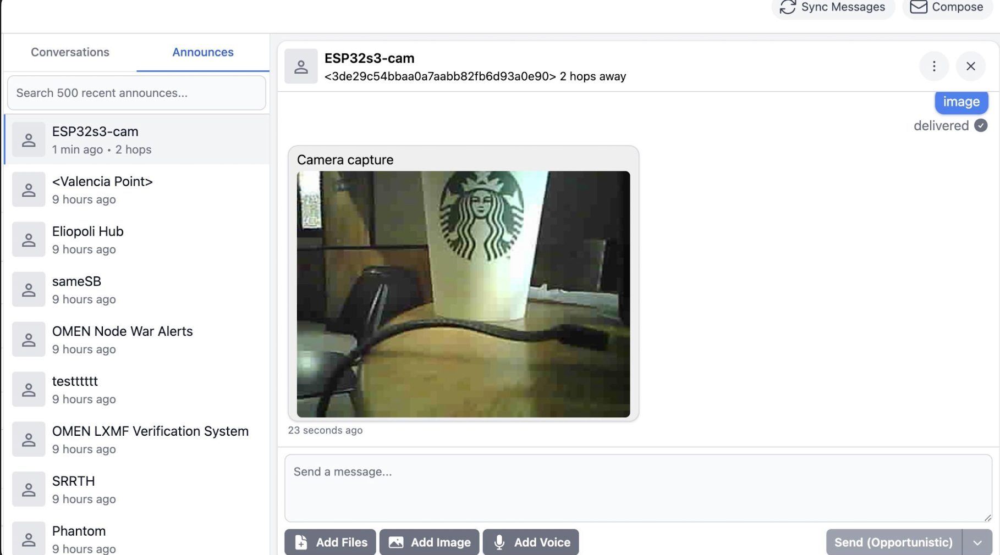

# Camera node (`example_camera_node.py`)

Captures a photo with an OV2640 and returns it as an LXMF image attachment, by default a **VGA (640 × 480) WebP** (~7 KB, small enough for LoRa), falling back to JPEG if the WebP encoder isn't installed.

- **Hardware**: ESP32-S3-CAM with OV2640 and PSRAM.
- **Firmware**: **camera-enabled MicroPython is mandatory** (see [Step 1](../../README.md#step-1--flash-micropython-to-your-board)); standard MicroPython fails at `import camera`.
- **Usage**: send `image` from MeshChat / Sideband (delivered via Link + Resource). Send `help` or `settings` for the live controls.
- **Settings**: resolution, WebP quality, exposure, flash and night mode are adjustable at runtime; see [Camera image settings](../CAMERA_WEBP.md).
- **WebP encoder**: optional native module `webp_fast.mpy` in `/lib` (source in [`tools/natmod/webp_fast/`](../../tools/natmod/webp_fast/)).

For direct capture from the REPL: `from peripherals.camera import capture`, then `capture(resolution="cif", quality=30)` saves to flash and `capture(path=None, resolution="qvga", quality=15)` returns the bytes. Resolutions run from `qqvga` (160 × 120) to `vga` (640 × 480) and larger.

[← back to the README](../../README.md#what-can-i-build-with-this)
